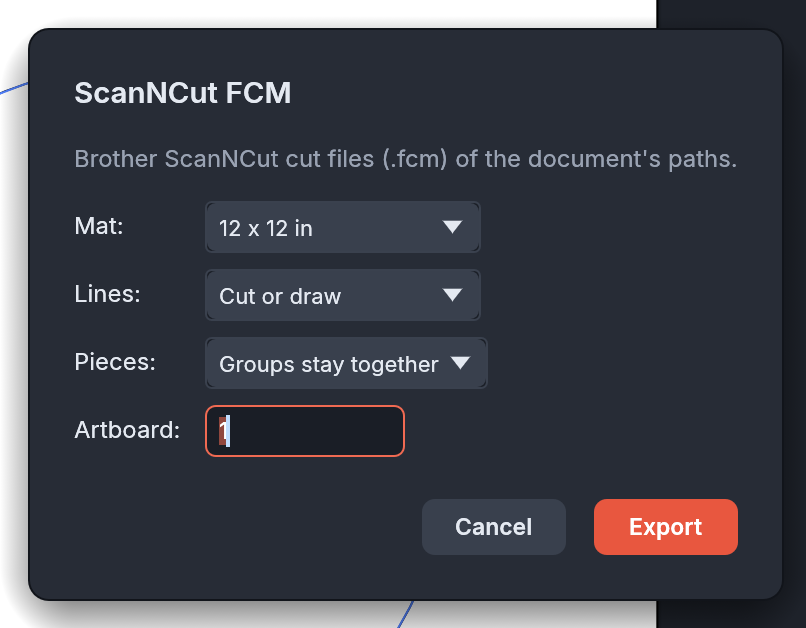
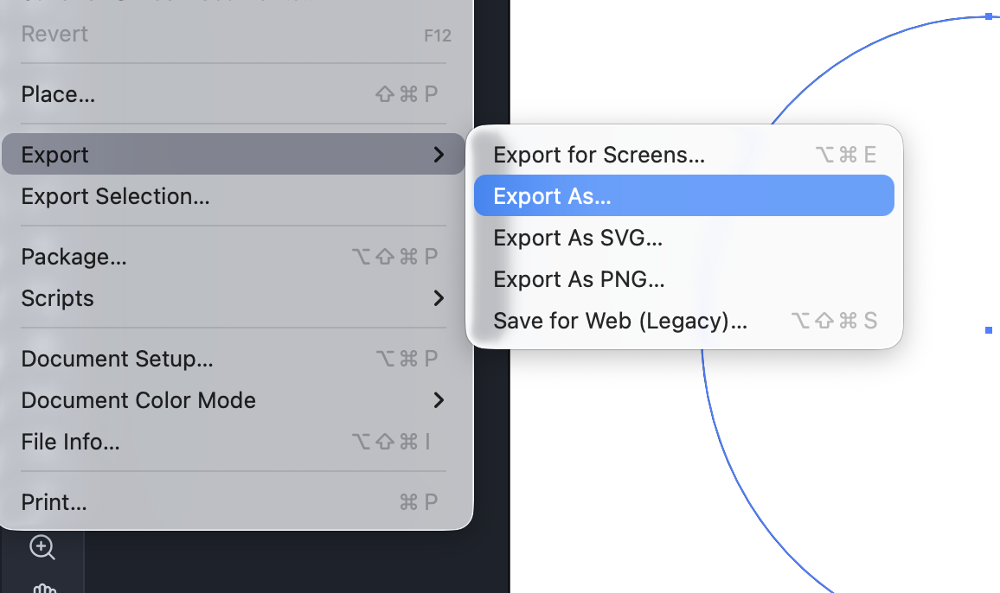
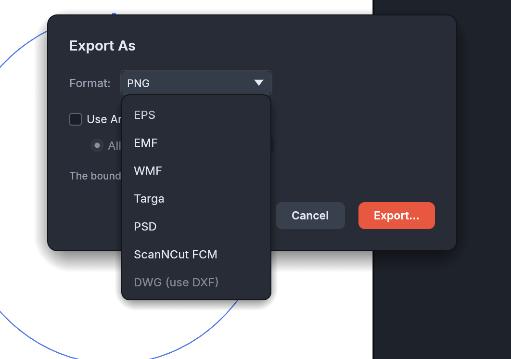

# VectorCraft → ScanNCut

Cut your [VectorCraft](https://github.com/storytold/vectorcraft) designs on a Brother ScanNCut.

This is a plug-in that adds **ScanNCut FCM** to VectorCraft's export formats. It saves the paths in
your drawing as an `.fcm` file, the cut-file format ScanNCut machines and CanvasWorkspace open. It
works in the VectorCraft desktop app and in the browser version.

## Installation guide (for dummies like me!)

You only need to do this once.

### 1. Get VectorCraft

Download VectorCraft from [getartcraft.com](https://getartcraft.com/apps/vectorcraft) or its
[releases page](https://github.com/storytold/vectorcraft/releases), and install it. You need
**version 0.16 or newer**. To check, look in VectorCraft's About window.

### 2. Download the plug-in

Download **[scanncut-fcm.wasm](https://github.com/plasticbugs/vectorcraft-scanncut/raw/main/vectorcraft-fcm/dist/scanncut-fcm.wasm)**.
It's one small file (about 135 KB). Remember where you saved it, probably your Downloads folder.

### 3. Install it in VectorCraft

1. Open VectorCraft.
2. Choose **File › Open…**
3. Pick the `scanncut-fcm.wasm` file you downloaded and click **Open**.

That's it. VectorCraft installs the plug-in instead of opening it as a drawing. The desktop app
remembers it, so you won't need to install it again. In the browser version, if it's gone after
you reload the page, open the file again.

## Cutting a design

### 1. Get your design ready

- **Put it in the top-left corner of the artboard.** The artboard's top-left corner becomes the
  top-left corner of the mat, and sizes come out exactly as drawn: 1 inch in VectorCraft is 1 inch
  on the mat.
- **Turn text into shapes.** Select the text and choose **Type › Create Outlines**. Text that isn't
  outlined is skipped.
- **Delete anything you don't want cut.** Every visible path is cut, including a background
  rectangle, whatever its colour. Hide a layer to leave its contents out.

### 2. Export

1. Choose **File › Export › Export As…**

   

2. Set **Format** to **ScanNCut FCM**, then click **Export…** and choose a name and folder.

   

3. Pick your options (the defaults are fine for most designs) and click **Export**.

   | Option   | What it means                                                                          |
   | -------- | -------------------------------------------------------------------------------------- |
   | Mat      | The mat you'll use: 12 x 12 in or 12 x 24 in                                           |
   | Lines    | **Cut or draw:** you choose on the machine. **Cut only** / **Draw only:** every line does that |
   | Pieces   | **Groups stay together:** each group moves as one piece on the machine. **Every path separately:** each shape is its own piece |
   | Artboard | Which artboard's top-left corner is the mat's corner (1 is the first)                   |

If anything was left out, VectorCraft shows a list of warnings after the export, saying what was
skipped and how to fix it.

### 3. Send it to the machine

Copy the `.fcm` file to a USB stick and open it on your ScanNCut. Or import it into CanvasWorkspace
and send it from there.

## Troubleshooting

| Problem                                   | Fix                                                                          |
| ----------------------------------------- | ---------------------------------------------------------------------------- |
| **ScanNCut FCM** isn't in the Format list | Install the plug-in (step 3 above), and check VectorCraft is 0.16 or newer    |
| Text didn't come out                      | Outline it first: **Type › Create Outlines**                                  |
| A big rectangle around everything got cut | That's the background shape: delete it, or hide its layer                    |
| Effects like Roughen or Warp were ignored | Apply them first: **Object › Expand Appearance**                              |
| Blends or repeats are missing             | Expand them first: **Object › Expand…**                                      |
| Part of the design hangs off the mat      | Move it inside the artboard's top-left area, or pick the 12 x 24 in mat      |

## What's in this repository

| Path                | What it is                                                                     |
| ------------------- | ------------------------------------------------------------------------------ |
| `vectorcraft-fcm/`  | The plug-in's source code (Rust, built to WebAssembly) and its tests          |
| `FCM-FORMAT.md`     | A description of the FCM file format, enough to write files the machine cuts  |
| `tools/`            | `fcmdump.py` (reads an FCM file and draws it as SVG) and `fcmwrite.py` (a small reference writer) |
| `samples/`          | Test sheets made by the writer and by the plug-in                              |

Building it yourself is covered in [`vectorcraft-fcm/README.md`](vectorcraft-fcm/README.md).

## Credits and notes

The file format was worked out with the help of [fcmlib](https://github.com/justjanne/fcmlib) by
Janne Mareike Koschinski, a Rust library used as a reference only (no code is copied), and checked
against real files.

Not affiliated with or endorsed by Brother. Brother and ScanNCut are trademarks of Brother
Industries, Ltd.

[MIT License](LICENSE)
